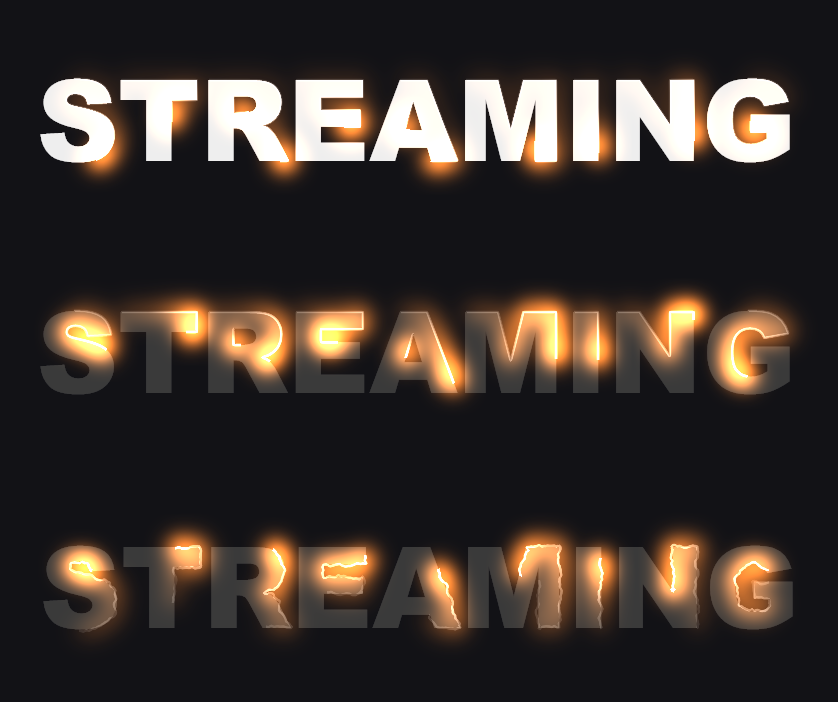

# Light Trace

*An OBS filter for images and text: a line of light runs along every outline of the source.*

Filtro para **OBS Studio** que traza los contornos de una imagen o un texto y hace correr una línea de luz por cada uno, como el efecto Vegas de After Effects: cada letra tiene su propia luz, y los huecos (el de la A, la R o la O) también.

*[English below](#english)*

Capturas del filtro en OBS sobre una fuente de texto: la luz a medio recorrido con la fuente visible, con la fuente atenuada, y con el temblor eléctrico. / Captures from OBS: halfway through with the source visible, with the source dimmed, and with electric jitter.

## Descarga e instalación

Descarga el último [release](https://github.com/hjmeneses/light-trace/releases/latest) (compilado para OBS 33):

- **Windows:** con OBS cerrado, descomprime el `.zip` en `C:\ProgramData\obs-studio\plugins`.
- **Ubuntu:** `sudo apt install ./light-trace-<versión>-x86_64-linux-gnu.deb`.
- **macOS:** instala el `.pkg`.

Luego, en una fuente de imagen o texto: **Filtros → + → Light Trace** (en español, **Trazo de luz**).

Para dispararlo con ▶ y mover el progreso sin abrir las propiedades, usa el dock [Shader Dock](https://github.com/hjmeneses/shader-dock) (nativo) o [obs-shader-dock](https://github.com/hjmeneses/obs-shader-dock) (de navegador).

> ¿Solo quieres algo rápido sin instalar un plugin? [obs-modern-tv](https://github.com/hjmeneses/obs-modern-tv) tiene `trazo-de-luz.shader` para obs-shaderfilter. Este plugin es la versión completa: sigue cada contorno en orden, letra por letra y con sus huecos, en lugar de barrer la imagen.

## Cómo funciona

Un shader no puede recorrer un contorno en orden: cada píxel se calcula solo, sin saber de qué contorno es ni en qué punto de su recorrido está. Este filtro hace esa parte en la CPU:

1. Cuando la fuente cambia (otro texto, otra fuente, otro archivo, otro tamaño), la dibuja una vez en una textura y la copia a la memoria.
2. Traza los contornos cerrados con *marching squares*: cada letra, cada hueco, cada mancha.
3. Guarda cada contorno como una línea ordenada, con la posición de cada punto en su recorrido.
4. En cada cuadro dibuja cada contorno como una cinta fina (el núcleo) en una textura, la desenfoca para el resplandor y lo suma sobre la fuente. Cuesta poco: no se vuelve a trazar nada.

Funciona con fuentes de **imagen** y **texto** (GDI+ y FreeType). En otras fuentes deja pasar la imagen sin cambios, porque trazar un video en cada cuadro sería mucho más pesado.

## Propiedades

| Grupo | Propiedad | Qué hace |
|---|---|---|
| Animación | En bucle / Duración | La luz da vueltas sin parar; una vuelta dura lo indicado |
| Animación | Progreso | Sin bucle: de 0 % (no salió) a 100 % (ya recorrió todo), para animarlo desde fuera o desde el dock |
| Animación | Desfase entre contornos | Cada letra arranca un poco después que la anterior, de izquierda a derecha |
| Animación | Sentido | Horario o antihorario |
| Animación | Huecos | Al revés del exterior (sigue el borde de la tinta), en el mismo sentido, o sin luz |
| Animación | Punto de arranque | Dónde sale la luz en cada contorno; 0 es su punto más alto |
| Luz | Largo de la estela | Qué fracción del contorno queda encendida detrás de la cabeza |
| Luz | Contorno ya recorrido | Brillo tenue que deja la luz al pasar |
| Luz | Grosor del núcleo, color del núcleo | La línea brillante |
| Luz | Tamaño, fuerza y color del resplandor | El halo alrededor |
| Luz | Ampliar el lienzo | Agranda la fuente unos px por lado para que el halo no se corte |
| Temblor eléctrico | Parpadeo | La energía se corta y vuelve a tramos |
| Temblor eléctrico | Sacudida del núcleo, velocidad | El núcleo tiembla hacia los lados |
| Contornos | Contorno de | Transparencia (alfa) o brillo, para logos sobre fondo negro |
| Contornos | Umbral del contorno | Dónde se corta: más bajo engorda el contorno, más alto lo adelgaza |
| Contornos | Largo mínimo de un contorno | Ignora manchitas y ruido del suavizado |
| Contornos | Mostrar contornos trazados | Prueba: cada contorno de un color, de oscuro a claro en el sentido del recorrido |
| Contornos | Volver a trazar | Por si la fuente cambió y el filtro no se enteró |

## Compilar

Igual que la [plantilla oficial de plugins de OBS](https://github.com/obsproject/obs-plugintemplate): `cmake --preset windows-x64` y `cmake --build build_x64 --config RelWithDebInfo`. Las pruebas del trazador no necesitan OBS: `tests/test_contours.c` se compila solo con `src/contours.c`.

## Transparencia y uso de IA

Siguiendo las [directrices de recursos de OBS](https://obsproject.com/forum/resources/) y la [política de IA de OBS Studio](https://github.com/obsproject/obs-studio/blob/master/CONTRIBUTING.md#aimachine-learning-policy):

- **Asistencia de IA:** Este plugin se desarrolló con apoyo de asistentes de programación de IA para la implementación en C (trazador *marching squares* y filtro GPU), las pruebas, el CI multiplataforma y la documentación, bajo dirección, revisión y pruebas del autor.
- **Verificación y pruebas:** Incluye pruebas unitarias independientes del trazador de contornos (`tests/test_contours.c`), compilación en CI para Windows, macOS y Ubuntu, y pruebas en vivo en OBS Studio 33.

---

## English

An OBS Studio filter that traces the outlines of an image or text source and runs a line of light along each one, like After Effects' Vegas: every letter gets its own light, and so do the holes in letters such as A, R or O.

Core, trail, glow and electric jitter, with configurable direction, start point and holes. It can be driven from [Shader Dock](https://github.com/hjmeneses/shader-dock) (native) or [obs-shader-dock](https://github.com/hjmeneses/obs-shader-dock) (browser): play, progress 0–100 %, loop, duration.

**Download:** [latest release](https://github.com/hjmeneses/light-trace/releases/latest) (built for OBS 33). Windows: with OBS closed, extract the zip into `C:\ProgramData\obs-studio\plugins`. Ubuntu: `sudo apt install ./light-trace-<version>-x86_64-linux-gnu.deb`. macOS: install the `.pkg`. Then add **Filters → + → Light Trace** to an image or text source.

A pixel shader can't follow an outline in order, so the filter does that part on the CPU: whenever the source changes it renders it once, reads it back, traces the closed outlines with marching squares and keeps each one as an ordered line with its position along the path. Each frame draws every outline as a thin ribbon (the core) into a texture, blurs it for the glow and adds both over the source. It works on image and text sources (GDI+ and FreeType); other sources pass through unchanged.

### Development Transparency & AI Disclosure

In compliance with the [OBS Project Resource Guidelines](https://obsproject.com/forum/resources/) and the [OBS AI/Machine Learning Policy](https://github.com/obsproject/obs-studio/blob/master/CONTRIBUTING.md#aimachine-learning-policy):

- **AI Assistance:** This plugin was developed with the assistance of AI coding tools for C implementation (marching squares contour tracer and GPU filter), tests, cross-platform CI, and documentation, under the author's direction, review, and testing.
- **Verification & Testing:** Includes standalone unit tests for the contour tracer (`tests/test_contours.c`), automated CI builds for Windows, macOS, and Ubuntu, and live testing in OBS Studio 33.

## License

GPL-2.0-or-later
